<div align="center">


<a href="https://git.io/typing-svg"></a>

<p>
  <a href="mailto:rakkarajput@gmail.com"></a>
  <a href="https://github.com/ThakurRakesh"></a>
  
</p>

</div>

---

## 👨‍💻 About Me

```csharp
public sealed class RakeshKumar : SeniorEngineer
{
    public string   Role       => "Senior .NET Full-Stack Engineer";
    public int      Experience => 8; // years and counting

    public string[] Core       => [ "C#", "ASP.NET Core", "Web API", "Blazor", ".NET MAUI", "EF Core", "SignalR" ];
    public string[] Data       => [ "SQL Server", "PostgreSQL", "MySQL", "MongoDB", "Redis", "SQLite" ];
    public string[] Frontend   => [ "React", "Angular", "TypeScript", "MudBlazor", "DevExpress" ];
    public string[] Cloud      => [ "Azure", "Key Vault", "Blob Storage", "Docker", "Kubernetes", "CI/CD" ];
    public string[] AI         => [ "Ollama", "Local LLMs", "RAG", "LoRA / QLoRA", "AI Agents", "Python" ];
    public string[] Domains    => [ "ERP", "Healthcare", "SaaS / PaaS", "Banking", "CRM", "Inventory", "Nursing Mgmt" ];

    public string   Focus      => "Offline-first apps, local LLMs & AI agents, secure-by-default design";
    public string   Leadership => "Team lead · technical ownership across the full SDLC";
}
```

- 🏗️ Architect at heart — **Clean Architecture, DDD, CQRS, microservices**, real-time with **SignalR**
- 🔐 Security-first — **AES-256-GCM** encryption, JWT/JWE, 2FA/OTP, signed binaries & integrity checks
- 🤖 Building **offline AI**: model training, local LLMs, RAG, scope-locked agents that never leave their lane
- 🎮 Ships games & consumer apps in **.NET MAUI / MonoGame / Stride** for Windows, Android & iOS

---

## 🛠️ Tech Stack

<div align="center">


<br/><br/>

<table>
  <tr>
    <td align="center" width="170"><b>💻 Languages</b></td>
    <td></td>
  </tr>
  <tr>
    <td align="center"><b>⚙️ Backend · .NET</b></td>
    <td>
      <br/>
      
      
      
      
      
      
      
      
      
    </td>
  </tr>
  <tr>
    <td align="center"><b>🎨 Frontend</b></td>
    <td>
      <br/>
      
      
      
    </td>
  </tr>
  <tr>
    <td align="center"><b>📱 Mobile · Desktop · Games</b></td>
    <td>
      <br/>
      
      
      
      
      
      
    </td>
  </tr>
  <tr>
    <td align="center"><b>🗄️ Databases</b></td>
    <td>
      <br/>
      
      
    </td>
  </tr>
  <tr>
    <td align="center"><b>☁️ Cloud · DevOps</b></td>
    <td>
      <br/>
      
      
      
      
    </td>
  </tr>
  <tr>
    <td align="center"><b>🤖 AI · ML</b></td>
    <td>
      <br/>
      
      
      
      
      
      
      
    </td>
  </tr>
  <tr>
    <td align="center"><b>🔐 Security</b></td>
    <td>
      
      
      
      
      
    </td>
  </tr>
  <tr>
    <td align="center"><b>🧰 Tools · Testing</b></td>
    <td>
      <br/>
      
      
    </td>
  </tr>
</table>

</div>

---

## 🆕 Recent Projects

> Built in 2026 — every one offline-capable and secured with AES-256.

<p align="center">
  <a href="https://github.com/ThakurRakesh/AIInterviewCoach"></a>
  <a href="https://github.com/ThakurRakesh/customLLMStudio"></a>
  <a href="https://github.com/ThakurRakesh/OfflineAgentPlatform"></a>
  
  <a href="https://github.com/ThakurRakesh/LocalLLMForge"></a>
  <a href="https://github.com/ThakurRakesh/InteriorDesign"></a>
  <a href="https://github.com/ThakurRakesh/kiranaLedger"></a>
</p>

## 🎮 Games & Apps

<p align="center">
  <a href="https://github.com/ThakurRakesh/last-pride-standing"></a>
  
  <a href="https://github.com/ThakurRakesh/RookAndRoast"></a>
  <a href="https://github.com/ThakurRakesh/RedlineRush"></a>
  
  <a href="https://github.com/ThakurRakesh/BoneCaller"></a>
  <a href="https://github.com/ThakurRakesh/pothi"></a>
  <a href="https://github.com/ThakurRakesh/Doomsday"></a>
  
</p>

---

## 🏆 Achievements

<div align="center">

| 🗓️ **8+ yrs** | 👥 **Team Lead** | 🏭 **10+ industries** | 🚀 **16+ products** |
|:-:|:-:|:-:|:-:|
| Enterprise .NET delivery | Led & managed dev teams | ERP · Healthcare · Banking · Pharma · Retail … | Apps & games built in 2026 |

</div>

- 🏪 **Published on the Microsoft Store** — *Last Pride Standing : Tower Defence* is live under publisher **rakkarajput**
- 🏥 Delivered **healthcare & nursing-management** systems and large **ERP / CRM / SaaS** platforms end-to-end
- 🏦 Worked on **banking & financial-services** projects, including enterprise work for a global bank
- 🔐 Standardised a **security-first blueprint** across all products: AES-256-GCM secrets, signed binaries, anti-tamper integrity checks
- 🌐 Shipped cross-platform apps to **Windows, Android & iOS** from a single .NET codebase
- 🤖 Built a fully **offline AI stack** — local model training, RAG and scope-locked agents with zero cloud dependency

<div align="center">


</div>

---

## 📊 Live GitHub Activity

<div align="center">

<picture>
  <source media="(prefers-color-scheme: dark)" srcset="https://raw.githubusercontent.com/ThakurRakesh/ThakurRakesh/output/github-snake-dark.svg"/>
  <source media="(prefers-color-scheme: light)" srcset="https://raw.githubusercontent.com/ThakurRakesh/ThakurRakesh/output/github-snake.svg"/>
  
</picture>


<sub>Graphs refresh automatically every day.</sub>

</div>

---

## 🤝 Let's Connect

I'm open to collaborating on **complex architecture, enterprise .NET, offline AI and secure systems**.

<div align="center">

<a href="mailto:rakkarajput@gmail.com"></a>

<sub>© 2022–2026 Rakesh Kumar &lt;rakkarajput@gmail.com&gt;. All rights reserved. My project repositories are **proprietary** — see each repo's LICENSE; viewing is not permission to reuse.</sub>


</div>
