<div align="center">



<a href="https://git.io/typing-svg"></a>

<p>
  <a href="mailto:rakkarajput@gmail.com"></a>
  <a href="https://github.com/ThakurRakesh"></a>
  
</p>

</div>

---

## 👨‍💻 About Me

```csharp
public sealed class RakeshKumar : SeniorEngineer
{
    public string   Company    => "🛡️ ZARQEV TECHNOLOGIES";
    public string   Motto      => "Intelligence Innovation Beyond Limits";
    public int      Experience => 8; // years and counting

    public string[] Core       => [ "C#", "ASP.NET Core", "Web API", "Blazor", ".NET MAUI", "EF Core", "SignalR" ];
    public string[] Data       => [ "SQL Server", "PostgreSQL", "MySQL", "MongoDB" ];
    public string[] Frontend   => [ "React", "Angular", "JavaScript", "MudBlazor", "DevExpress" ];
    public string[] Cloud      => [ "Azure App Service", "Key Vault", "Blob Storage", "Docker", "Kubernetes", "CI/CD" ];
    public string[] Domains    => [ "ERP", "Healthcare", "SaaS / PaaS", "Banking", "CRM", "Inventory", "Nursing Mgmt" ];

    public string   Focus      => "Offline-first apps, local LLMs & AI agents, secure-by-default design";
    public string   Leadership => "Team lead · technical ownership across the full SDLC";
}
```

- 🏗️ Architect at heart — **Clean Architecture, DDD, CQRS, microservices**, real-time with **SignalR**
- 🔐 Security-first — **AES-256-GCM** encryption, JWT/JWE, 2FA/OTP, signed binaries & integrity checks
- 🤖 Building **offline AI**: local LLMs, RAG, scope-locked agents that never leave their lane
- 🎮 Ships games & consumer apps in **.NET MAUI / MonoGame** for Windows, Android & iOS

---

## 🛠️ Tech Stack

<div align="center">

<br/>
<br/>


<br/>


</div>

---

## 🆕 Recent Projects

> Built in 2026 under **🛡️ ZARQEV TECHNOLOGIES** — every one offline-capable and secured with AES-256.

| | Project | What it is | Stack |
|:-:|---|---|---|
| 🎯 | **[AI Interview Coach](https://github.com/ThakurRakesh/AIInterviewCoach)** | AI mock-interview panel (dev → CTO) with proctoring, multi-round scoring & offline compilers | .NET MAUI · Local LLMs · SignalR |
| 🧠 | **[Custom LLM Studio](https://github.com/ThakurRakesh/customLLMStudio)** | Train models from scratch, build scope-locked agents/bots, Ollama-style endpoints | .NET · Local LLMs |
| 🤖 | **[Offline Agent Platform](https://github.com/ThakurRakesh/OfflineAgentPlatform)** | 100% offline multi-agent platform with RAG and DB-agnostic access | C# · Clean Arch · DDD · Ollama |
| 🏠 | **[Design Studio 3D](https://github.com/ThakurRakesh/InteriorDesign)** | Interior / exterior 3D design with an on-device AI assistant | .NET MAUI · Local LLM |
| 🧾 | **[Kirana Ledger](https://github.com/ThakurRakesh/kiranaLedger)** | Multi-tenant SaaS for Indian general stores — GST billing, stock & udhar | Blazor · MudBlazor · MAUI |
| ⚒️ | **[LLM Forge](https://github.com/ThakurRakesh/LocalLLMForge)** | Run & fine-tune local LLMs on Android / Windows | .NET MAUI |
| 🧪 | **Offline Local AI Trainer** | Discover & test Ollama models, manage datasets, orchestrate LoRA / QLoRA training | .NET 10 · Blazor Hybrid · MAUI · Python |

## 🎮 Games & Apps

| | Title | Highlights | Platforms |
|:-:|---|---|---|
| 🏰 | **[Last Pride Standing : Tower Defence](https://github.com/ThakurRakesh/last-pride-standing)** | Endless offline tower defence — **live on the Microsoft Store** | Windows |
| ♟️ | **[Rook & Roast](https://github.com/ThakurRakesh/RookAndRoast)** | Self-learning, always-hard chess AI that roasts you | Windows · Android · iOS |
| 🏎️ | **[Redline Rush](https://github.com/ThakurRakesh/RedlineRush)** | Arcade racing | MonoGame — Win · Android · iOS |
| 💀 | **[BoneCaller](https://github.com/ThakurRakesh/BoneCaller)** | Necromancer action game | Windows · Android |
| ⚔️ | **Card Hero Battle** | Competitive hero card battler — 2P/4P ratings, LAN & online, server-authoritative matches | Stride · .NET 10 · ASP.NET Core |
| 🃏 | **Royal Sweep: Seep Card Game** | Classic Indian Seep — vs AI, pass-and-play, LAN & room-code online | .NET 10 MAUI |
| 🕉️ | **[MyPanditG](https://github.com/ThakurRakesh/pothi)** | Offline panchang, kundali, matching & puja vidhi | Android · Windows |
| ☢️ | **[Doomsday](https://github.com/ThakurRakesh/Doomsday)** | Offline survival handbook app | Android · Windows |
| 🧹 | **CleanSweep** | Mobile cache cleaner | .NET MAUI |

---

## 🏆 Achievements

<div align="center">

| 🗓️ **8+ yrs** | 👥 **Team Lead** | 🏭 **10+ industries** | 🚀 **16+ products** |
|:-:|:-:|:-:|:-:|
| Enterprise .NET delivery | Led & managed dev teams | ERP · Healthcare · Banking · Pharma · Retail … | Apps & games built in 2026 |

</div>

- 🏪 **Published on the Microsoft Store** — *Last Pride Standing : Tower Defence* is live under publisher **rakkarajput**
- 🏥 Delivered **healthcare & nursing-management** systems and large **ERP / CRM / SaaS** platforms end-to-end
- 🏦 Worked on **banking & financial-services** projects, including enterprise work for a global bank
- 🔐 Standardised a **security-first blueprint** across all products: AES-256-GCM secrets, signed binaries, anti-tamper integrity checks
- 🌐 Shipped cross-platform apps to **Windows, Android & iOS** from a single .NET codebase
- 🤖 Built a fully **offline AI stack** — local model training, RAG and scope-locked agents with zero cloud dependency

<div align="center">


</div>

---

## 📊 GitHub Stats

<div align="center">


</div>

---

## 🤝 Let's Connect

I'm open to collaborating on **complex architecture, enterprise .NET, offline AI and secure systems**.

<div align="center">

<a href="mailto:rakkarajput@gmail.com"></a>

<sub>© 2022–2026 Rakesh Kumar &lt;rakkarajput@gmail.com&gt;. All rights reserved. My project repositories are **proprietary** — see each repo's LICENSE; viewing is not permission to reuse.</sub>


</div>
